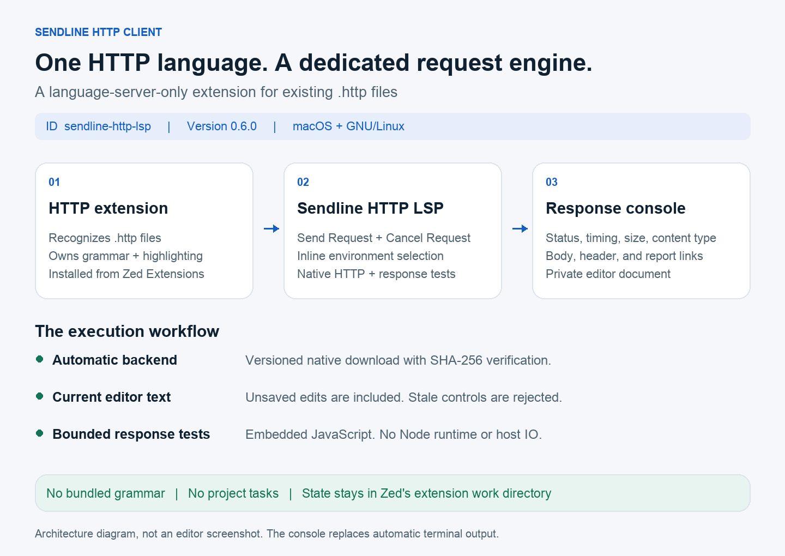

# Sendline HTTP Client for Zed

Run `.http` requests from Zed, choose an environment, and open private response files. Sendline is a language-server extension for the existing **HTTP** language. The **HTTP** extension owns syntax highlighting. Sendline owns execution, environments, diagnostics, and response tests.



The diagram describes the integration. It is not an editor screenshot.

Native downloads are available in [GitHub Releases](https://github.com/Prajwal-ak-0/zed-sendline/releases). Installation from Zed's registry awaits review and publication of [the registry submission](https://github.com/zed-industries/extensions/pull/8154).

```http
### Get current user
GET {{baseUrl}}/api/users/me
Authorization: Bearer {{token}}

> 
```

## Install from Zed

After the registry submission is approved:

1. Install **HTTP** in Zed's Extensions view for syntax highlighting and file recognition.
2. Install **Sendline HTTP Client**, extension ID `sendline-http-lsp`.
3. Open your project and a `.http` file. Trust your own project when Zed asks.
4. Enable inline controls in your Zed settings:

```json
{
  "languages": {
    "http": {"code_lens": "on"}
  }
}
```

The published HTTP provider uses the language name `http`, in lowercase. Merge that entry into your existing settings. For `.rest` files, select `http` in Zed's language picker. With CodeLens disabled, place your cursor in a request and run **editor: toggle code actions**. Sending, cancellation, environment choices, and response links are available there too.

Sendline downloads and verifies its matching native backend automatically. It requires no Rust installation, Node.js runtime, external HTTP CLI, or project task file. macOS and GNU/Linux on Intel and ARM64 are supported. Linux requires glibc 2.35 or newer. Windows is not supported.

If you use another HTTP language server, set `languages.http.language_servers` to `["sendline"]` to select Sendline. Keep the HTTP language extension installed.

See [the comparison with existing HTTP extensions](docs/comparison.md) for the scope and setup differences.

## Use environments

Put `http-client.env.json` beside your requests or in a parent directory:

```json
{
  "$shared": {"apiVersion": "v1"},
  "local": {"baseUrl": "http://localhost:8000"},
  "staging": {"baseUrl": "https://staging.example.com"}
}
```

Put tokens in `http-client.private.env.json` in the same directory, and add that filename to your project's `.gitignore`:

```json
{
  "local": {"token": "your-local-token"},
  "staging": {"token": "your-staging-token"}
}
```

Click the header to reveal environment choices beside it. Click a choice to select it and collapse the list. Click the header again to close the choices without changing environments. Zed extensions cannot position a custom dropdown beneath the header.

The selector stays available while requests contain syntax errors or unsupported response scripts. Multiline URLs with indented `?` and `&` query parameters are supported.

If a saved environment is removed, select another environment before sending. The client does not silently switch to a different server.

Your choice is shared by files using the same environment directory and survives editor and language-server restarts. A `# @env local` comment supplies the initial choice. Otherwise, `local` is the initial default when available. A sole environment is selected automatically. With multiple environments and no default, select one before running a request.

The nearest parent directory containing either environment file supplies both files. Private values override public values. A selected environment overrides `$shared` within each file. File declarations such as `@name = value` override environment variables. Nested variables and JSON objects or arrays work. For example, `{{account.ids[0]}}` reads a structured environment value. Missing and circular variables stop the request before it is sent.

## Send requests and inspect responses

Click **Send Request** above an endpoint. Sendline executes the current editor text, including unsaved edits. The document must have a file path so environment files can be found. It rejects a stale button action if the document changed before the action arrived.

The response console is an editor document with the environment, redacted endpoint, HTTP status, duration, size, and content type. It opens metadata without requesting editor focus. The response body stays in a separate file until you choose **Response** or **Open response**. Headers and test reports have their own links.

While a request is active, **Cancel Request** replaces its send control. Only one request runs per document. Other documents can run independently. Closing the request document or stopping the language server cancels its active operation.

HTTP errors and failed response tests preserve the body, headers, and report. Network failures appear in the console. Request authorization, body values, URL user information, and query values stay out of console metadata. Script logs and assertion messages remain in the private test report because they may contain response data.

The console is a generated, read-only metadata file. Each run has its own files, so overlapping work cannot overwrite another run's console. Response files remain available after a language-server restart. Zed's Markdown preview can render console links; the request's **Response**, **Headers**, and **Tests** controls also open those files directly.

Inside Zed, state and artifacts live under `state/` in Zed's designated `extensions/work/sendline-http-lsp` directory. Sendline does not write project tasks, global settings, or a launcher in your home cache.

This version uses inline Send Request controls and an editor response console. It does not supply gutter tasks or automatically open a terminal.

## Build and install locally

Requires Rust through rustup and Zed:

```sh
./scripts/package.sh
python3 scripts/install.py --replace-legacy --enable-buttons
```

The development installer preserves this checkout's previous Sendline installation in Zed's `extensions/local-backups` directory. It refuses to replace an installation it does not own. Install the **HTTP** language extension separately, restart the language server, then close and reopen your `.http` file.

The package contains the WASM adapter and manifest. It has no grammar, highlighting queries, or task definitions. The development installer seeds the native binary in the same versioned extension work directory used by registry downloads. A custom backend can be selected with `lsp.sendline.binary.path`; its version must match the extension.

Try the loopback-only demo:

```sh
python3 examples/server.py
```

Open `examples/requests.http`, choose `local`, and click **Send Request**.

## Use the standalone CLI

The native executable also supports terminal use:

```sh
./bin/sendline run --file examples/requests.http --line 3 --environment local
```

CLI output shows response metadata and file paths. Ctrl-C cancels the request. The CLI's default private cache is `~/Library/Caches/sendline` on macOS and `$XDG_CACHE_HOME/sendline` or `~/.cache/sendline` on Linux. `SENDLINE_HOME` overrides that location. Zed supplies its own extension work directory instead.

## Supported requests

GET, POST, PUT, PATCH, DELETE, HEAD, OPTIONS, TRACE, and CONNECT are supported. Separate requests with `###`. No additional blank line is needed before the method. Headers, bearer tokens, Basic authentication, JSON and text bodies, CRLF files, and Unicode bodies work.

Basic authentication accepts an encoded value or `Authorization: Basic username password`. Built-in variables include `{{$uuid}}`, `{{$guid}}`, `{{$timestamp}}`, and `{{$datetime}}`.

TLS verification stays enabled. Connections time out after 10 seconds and complete requests after 30 seconds. Same-origin redirects are limited to 10. A redirect to a different scheme, host, or port is returned as a 3xx response without forwarding credentials. Send a separate request to that destination if intended. Responses are limited to 10 MiB. Multipart helpers, external file bodies, external JavaScript imports, pre-request scripts, asynchronous handlers, and cookie persistence are not implemented.

## Response scripts and tests

Inline JetBrains response handlers run after the HTTP response arrives:

```http
GET {{baseUrl}}/api/items

> 
```

The script receives `response.status`, the parsed JSON or text `response.body`, `response.contentType`, and `response.headers.valueOf`, `valuesOf`, and `all`. `client.test` registers tests that run after the handler, in order. A failed assertion marks the run unsuccessful; other tests still run. The response remains available even when a test or script fails.

`client.global.set`, `get`, `clear`, `clearAll`, and `isEmpty` work with JSON values. Saved values are available as `{{name}}` in later requests. JSON property and index paths work too, for example `{{items[0]["id"]}}` or `{{user.profile.name}}`. Globals persist privately in this client's cache and are isolated by environment directory and environment name. Environment variables override globals; file declarations override both. Concurrent requests merge their changes without overwriting unrelated variables. Use `client.global.clearAll()` to clear that environment's saved variables.

The response console shows passed and failed counts and a link to the private test report. That private JSON file contains test names, assertion details, and `client.log` or `console.log` output. Logs and assertion messages stay out of console metadata because they can contain tokens or response data.

Scripts run in an embedded QuickJS engine; Node.js is not required. Each handler is limited to one second and 128 MiB, without filesystem, process, or network APIs. Script syntax is checked before sending, without executing the handler. Unsupported external script and body directives fail before sending.

## Compatibility

Sendline supports the request, environment, and inline response-test workflows described above. It does not implement every JetBrains HTTP Client API. See the unsupported features above before moving an existing collection. After a response script saves globals, diagnostics for dependent open requests refresh automatically within about one second.

## Verify changes

```sh
scripts/check.sh --integration
```

The verification scripts use loopback HTTP servers and real LSP and CLI processes. They check inline selection, persisted environments, unsaved editor snapshots, stale controls, cancellation, document lifecycle, filenames containing shell characters, seven HTTP methods, private responses, Unicode bodies, HTTP errors, redaction, response handlers, script limits, and environment-scoped variable chaining.

Based on [doani/zed-restclient](https://github.com/doani/zed-restclient), under the included MIT license.
